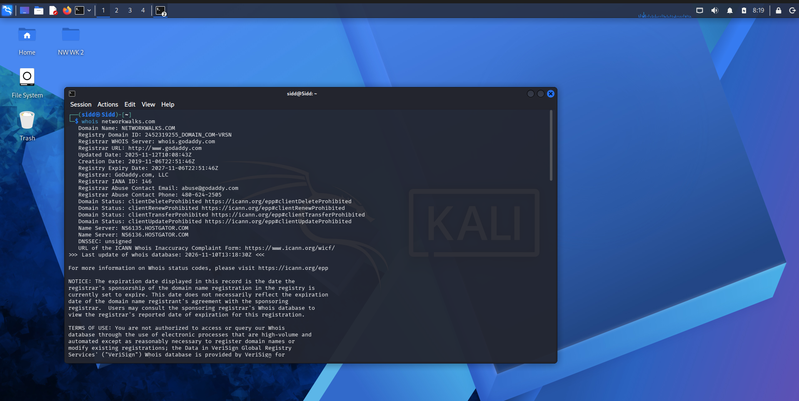
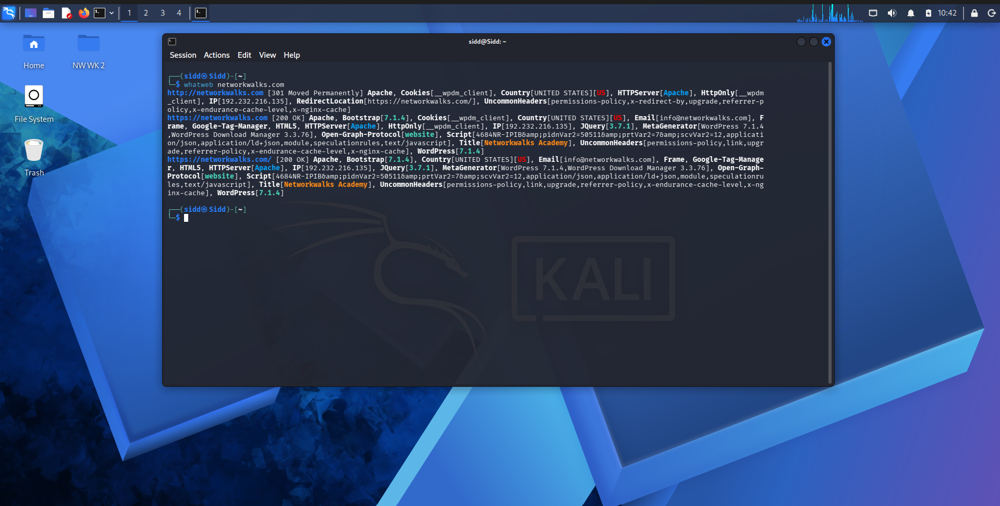
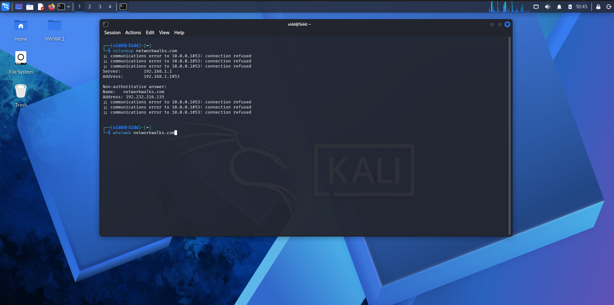
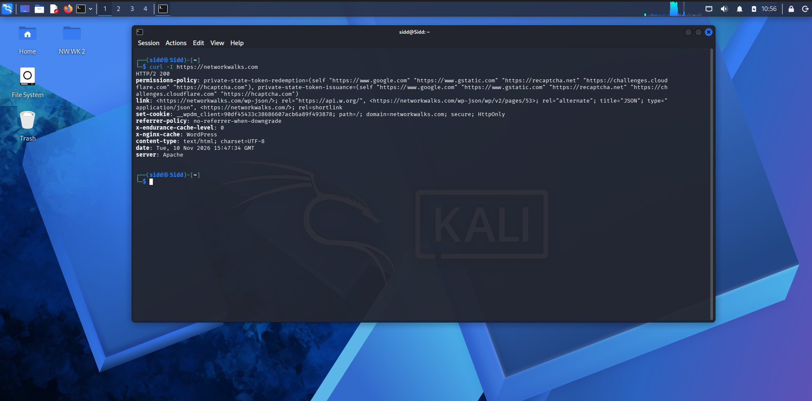
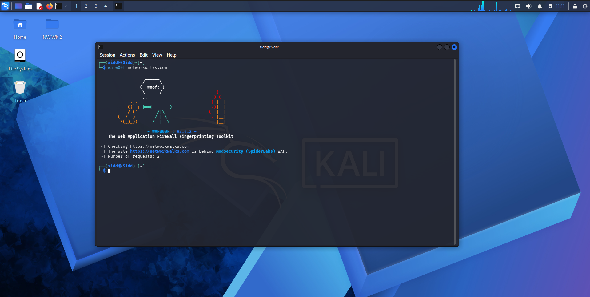
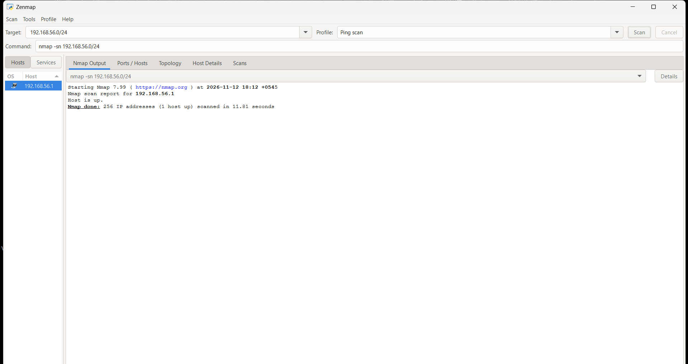
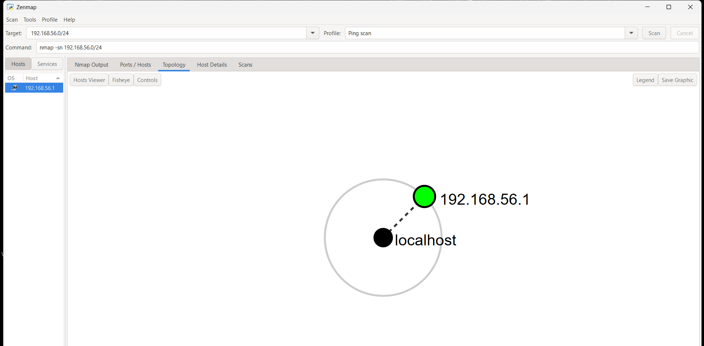

# PENETRATION TESTING REPORT 
### Footprinting & Network Scanning Phases

**W2-PM-FINAL  |  CYBERSECURITY  |  NETWORKWALKS**

| Field | Detail |
|---|---|
| **Pentester Name (Cybersecurity Professional)** | **Siddhartha Gautam** |
| **Program/Batch** | B084-Networkwalks |
| **Date** | 10 November 2026 |
| **Modules completed** | W2-PM1 (Multiple Kali Tools) W2-PM5 (Zenmap Scanning) |
| **Client/Target** | 1. Networkwalks (secured written permission already) 2. My own local LAN Network |
| **Permission secured from client?** | Yes |
| **Phases covered** | **Phase 1:** Reconnaissance & Footprinting **Phase 2:** Scanning & Network Discovery **Phase 3-5:** In Progress |

# 1. Liability Disclaimer

I have only carried out these actions on systems and devices that I own or on which I have obtained formal authorization. All of these resources are solely for educational and research purposes. Nothing from here should be used to violate the law. You are accountable for every action you take. Misuse can result in a permanent record, severe penalties, job loss, and criminal charges. Unauthorized access is illegal in the majority of countries, even if no harm is done.
 PS: The instructor, the authors and Networkwalks are not responsible for what you do with this knowledge. Every action you take is your own responsibility.

# 2. Introduction
This report covers reconnaissance of networkwalks.com domain using multiple kali linux tools (1st module) and scanning my own local network using Zenmap (2nd module). The first module covers footprinting phase while the second module covers scanning phase; these phases are the initial steps to pen-testing.  Thus, together they show how an attacker moves from gathering public information to mapping live hosts on a network.
It is the Week 2 part of my ongoing internship program at Networkwalks.

# 3. Tools Used
The table below lists each tool used in this report and its purpose.
| Tool | Purpose |
|---|---|
| Kali Linux & Windows | Operating systems used for recon activities             |
| whois                | Finds domain registration details (owner, dates, name servers).   |
| whatweb              | Fingerprints web technologies (server, CMS, plugins, IP).         |
| nslookup             | Resolves the domain name to its IP address using DNS.             |
| curl -I              | Reads the HTTP response headers of the website.                   |
| wafw00f              | Detects whether a Web Application Firewall protects the site.     |
| dnsrecon             | Enumerates all DNS records (NS, MX, SPF, TXT, SRV).               |
| Zenmap (Nmap GUI)    | Scans the local subnet to find live hosts, IPs and MAC addresses. |
| Windows CMD          | Local IP and MAC address identification                          |

# 4. Activities Performed
## 4.1 Footprinting & Reconnaissance

Using six Kali Linux tools—WHOIS, WhatWeb, Nslookup, Curl, Wafw00f, and DNSRecon—I conducted reconnaissance against the networkwalks.com domain. Different kinds of information on the target were gathered using each instrument.

I started by using **whois** to find the domain's name servers and collect publicly accessible domain registration information. Information regarding domain registration and hosting infrastructure was obtained from the results.

I then used **whatweb** to determine which technologies the website was using. WordPress 7.0.4 and WP Download Manager 3.3.58 were found in the results, along with further data that the website disclosed.

I was able to resolve the domain name to its IP address using **Nslookup**. 192.232.216.135 was found in the given result.

I examined the HTTP response headers using Curl and the -I option. This revealed the WordPress REST API endpoint /wp-json/ and offered more details about the web application.

I then used **wafw00f** to check if the website was protected by a Web Application Firewall. ModSecurity (SpiderLabs) was found in the outcome.

Lastly, I enumerated DNS records using **dnsrecon**. Name servers, mail servers, SPF/TXT records, service records, and DNS software information were all included in the results.

## 4.2 Network Scanning with Zenmap

For the second activity, I used Zenmap to perform network discovery on my local network. The practical required me to identify my local IP address and subnet, discover live hosts, identify their IP and MAC addresses, and generate a network topology. 
I first used the Windows ipconfig command to identify my local IP address and LAN subnet. I then entered the subnet into Zenmap and selected Ping Scan to identify active hosts. 
The example results provided in the practical identified one live host: 
•	192.168.56.1 
The example result didn’t include any MAC addresses. But, I scanned the mac address using ipconfig/all in my Windows cmd.
Also, I opened the Topology section in Zenmap, enabled the legend and saved the network topology in PDF format as required by the practical task.

# 5. Risk Analysis / Impact

Based on the information collected during the footprinting and network scanning activities, I identified the following potential risks.

| **\#** | **Risk / Finding**                           | **Evidence / Observation**                                  | **Potential Impact**                                                                                            | **Risk Level** |
|--------|----------------------------------------------|-------------------------------------------------------------|-----------------------------------------------------------------------------------------------------------------|----------------|
| 1      | Web technology information exposed           | WhatWeb identified WordPress and WP Download Manager        | Attackers may use exposed technology/version information to identify software requiring further security review | **● Medium**   |
| 2      | Server IP address identifiable               | Nslookup resolved the domain to `192.232.216.135`           | Provides information about the network location of the web service                                              | **● Low**      |
| 3      | HTTP technical information exposed           | Curl returned HTTP response headers and exposed `/wp-json/` | May assist technology fingerprinting and further enumeration                                                    | **● Low**      |
| 4      | WAF technology identifiable                  | Wafw00f identified ModSecurity (SpiderLabs)                 | Reveals information about the web application’s security architecture                                           | **● Low**      |
| 5      | DNS infrastructure information exposed       | DNSRecon identified DNS, mail and service-related records   | DNS information can help build a broader infrastructure profile                                                 | **● Medium**   |
| 6      | Multiple live hosts visible on local network | Zenmap identified four live hosts in the example network    | Unknown or unauthorized devices may potentially be present on a network                                         | **● Medium**   |

**Risk level key:** ● Critical ● Medium ● Low

The risks above are observations from the footprinting and scanning exercises, not confirmed vulnerabilities.

The practical exercises primarily involved information gathering and host discovery. No exploitation or vulnerability validation was performed as part of these two modules.

Therefore, the presence of information such as a software version, IP address or DNS record does not by itself mean that the system is vulnerable. Further authorized security testing would be required to confirm any actual vulnerability.

# 6. Recommendations

Based on the observations from these activities, I recommend the following security improvements:

1.  **Review publicly exposed technology information**  
    Organizations should regularly review what information about their web technologies, CMS and plugins is publicly visible.

2.  **Keep software updated**  
    CMS platforms, plugins and other web technologies should be regularly updated and reviewed against current security advisories.

3.  **Review HTTP headers**  
    HTTP response headers should be reviewed to determine whether unnecessary technical information is being exposed.

4.  **Review DNS records regularly**  
    DNS records should be checked periodically to ensure that only required information and services are publicly exposed.

5.  **Properly configure and monitor the WAF**  
    Keep the WAF (ModSecurity) enabled and tuned, since it already blocks naive attacks.

6.  **Perform regular internal network discovery**  
    Organizations should periodically scan their own networks to identify active devices.

7.  **Investigate unknown devices**  
    Any unexpected device discovered during network scanning should be investigated and verified.

8.  **Maintain network documentation**  
    Network topology and device information should be documented and updated regularly.

9.  **Perform security testing with authorization**  
    Reconnaissance and scanning should only be performed against systems and networks where appropriate authorization has been provided.

# 7. Conclusion

I finished hands-on exercises in network scanning, footprinting, and reconnaissance during the second week of my internship in cybersecurity and ethical hacking. 
I gathered data on the target domain in the footprinting exercise using six Kali Linux tools.  I discovered that Wafw00f can detect a WAF, DNSRecon can offer more DNS information, WhatWeb can identify web technologies, Nslookup can resolve domain names, Curl can examine HTTP headers, and WHOIS can provide domain information. 
I used Zenmap to find active hosts and determine my local network settings for the network scanning exercise. In addition, I made a network architecture and gathered IP and MAC address data. 
I learned from the exercises how crucial information collection is to cybersecurity i.e. by closely examining publicly available data and network replies, a security expert can learn a great deal about an environment even before attempting to exploit a system. 
I also discovered the importance of clearly documenting technical discoveries. An effective cybersecurity report should include what was done, what was found, the significance of the observation, the potential danger it poses, and how to mitigate that risk. 
Lastly, I discovered that scanning and reconnaissance must always be done within a permitted scope. As part of the designated instructional cybersecurity lab, these tasks were finished.

# 8. Evidences

*Screenshots collected as evidence during the activities (stored in the `screenshots/` folder):*

-End-

